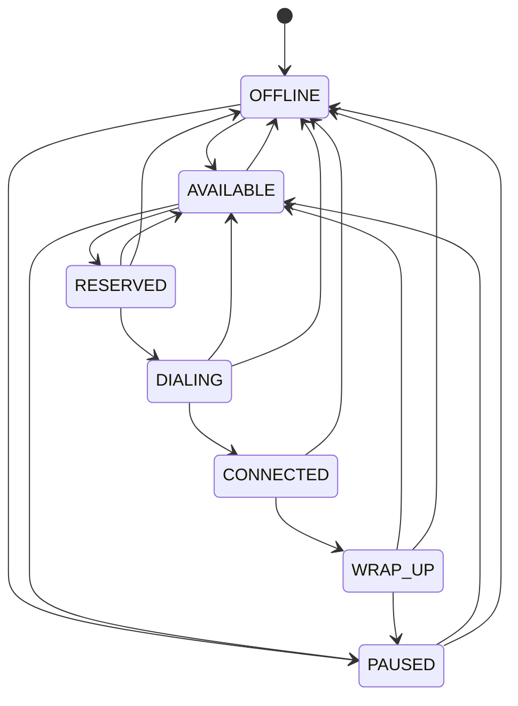

# Agent State Machine

## Overview

The agent state machine controls the lifecycle of an agent from being offline to becoming available, handling a call, and returning to an available or paused state.

## State Diagram



## State Definitions

| State | Meaning | Allowed Next States | Why |
|---|---|---|---|
| OFFLINE | Agent is not participating in dialing. | AVAILABLE, PAUSED | Agent can become available or enter a paused state. |
| AVAILABLE | Agent is ready to receive a call. | RESERVED, PAUSED, OFFLINE | Agent can be reserved for a call, paused, or taken offline. |
| RESERVED | Agent has been atomically reserved for a specific call. | DIALING, AVAILABLE, OFFLINE | Dialing can begin, or the reservation can be released. |
| DIALING | The system is attempting to connect the agent to a call. | CONNECTED, AVAILABLE, OFFLINE | The call can connect, or the agent can be released. |
| CONNECTED | Agent is connected to the call. | WRAP_UP, OFFLINE | The agent can enter wrap-up or go offline. |
| WRAP_UP | Agent is completing post-call work. | AVAILABLE, PAUSED, OFFLINE | Agent can become available again, pause, or go offline. |
| PAUSED | Agent is temporarily unavailable for calls. | AVAILABLE, OFFLINE | Agent can resume availability or go offline. |

## Atomic Agent Reservation

Agent reservation is performed using a single atomic conditional SQL UPDATE inside a `BEGIN IMMEDIATE` transaction.

```sql
UPDATE agents
SET state = 'RESERVED'
WHERE id IN (
    SELECT id
    FROM agents
    WHERE state = 'AVAILABLE'
    ORDER BY available_since
    LIMIT ?
)
AND state = 'AVAILABLE'
RETURNING id;
```

This operation:

- Selects only agents currently in the `AVAILABLE` state.
- Prioritizes agents using `available_since`.
- Reserves the selected agents through one atomic UPDATE.
- Returns the IDs of the agents successfully reserved.

The `BEGIN IMMEDIATE` transaction ensures that competing workers cannot independently reserve the same available agents.

## Call Ownership and Side-Effect Protection

An agent remains bound to its call through `reserved_call_id`.

The binding remains in place while the agent moves through the active call lifecycle:

- RESERVED
- DIALING
- CONNECTED
- WRAP_UP

The binding is cleared only when the agent returns to one of these states:

- AVAILABLE
- PAUSED
- OFFLINE

Every call-related agent side effect is guarded by the corresponding `call_id`.

This prevents a late event from an old call from releasing or modifying an agent who has already been assigned to a different call.

For example, if an agent finishes Call A and is subsequently assigned Call B, a delayed event from Call A cannot release the agent currently handling Call B.