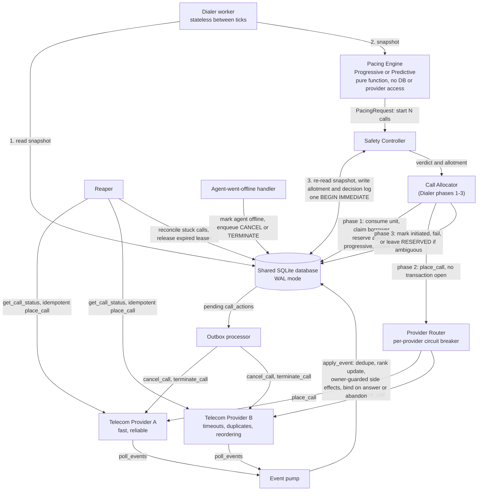

# SmartDialer Architecture

## One dialer tick (any worker; workers are stateless, all shared state is in SQLite)

The diagram deliberately has no database-to-provider edge. Providers are reached only by the router (placement), the outbox processor (cancel/terminate) and the reaper (ground-truth queries), and they reach the system only through the event pump.

## Tables

`agents`, `agent_events`, `borrowers`, `calls`, `call_events`, `call_actions` (the outbox), `safety_state`, `safety_allotments`, `safety_decisions`.

## Components

| Component | Responsibility |
|---|---|
| Pacing Engine | Pure function of a snapshot; returns a request for N calls, never an order. |
| Safety Controller | One write transaction: re-reads state, checks providers, abandon-rate breaker, statistical risk bound, caps; writes an allotment and a decision log row; fails closed. |
| Call Allocator | Phase 1 (transaction): consume allotment unit, claim borrower, reserve agent if progressive, create call. Phase 2 (no transaction): provider. Phase 3 (transaction): record outcome. |
| Provider Router | Per-provider circuit breaker; fails over only on a definite error; never on a timeout (retries the same provider with the same call_id, otherwise AMBIGUOUS). |
| Event pump | Applies provider events through `apply_event`: dedupe, rank-monotonic update, side effects guarded by the owning call, bind-on-answer or abandon. |
| Outbox processor | Executes CANCEL and TERMINATE against providers, outside transactions, with leases and retries. |
| Reaper | Reconciles RESERVED and stuck calls against provider ground truth; releases expired claims and reservations. |
| Agent-went-offline handler | Abandons and terminates a connected call; cancels a call that is still in setup. |

See `architecture_decisions.md` for why, and `scale_and_final_answer.md` for what breaks first.