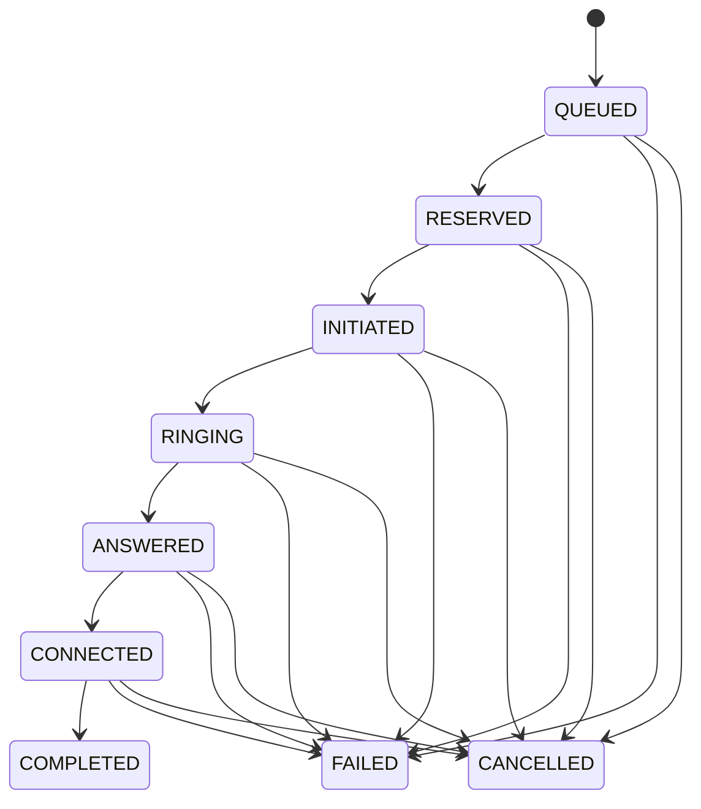

# Call State Machine

## Overview

The call state machine manages the lifecycle of an outbound call.

Provider events are processed according to their state rank. Only valid forward transitions are applied, while duplicate, stale, terminal, and unknown-call events are handled separately.

## State Diagram



## State Definitions and Ranks

| State | Rank | Meaning |
|---|---:|---|
| QUEUED | 0 | Call is waiting to be processed. |
| RESERVED | 1 | Call has been reserved for processing. |
| INITIATED | 2 | Call initiation has started. |
| RINGING | 3 | The destination is ringing. |
| ANSWERED | 4 | The destination has answered. |
| CONNECTED | 5 | The call is connected. |
| COMPLETED | 6 | Call has completed. Terminal state. |
| FAILED | 6 | Call has failed. Terminal state. |
| CANCELLED | 6 | Call has been cancelled. Terminal state. |

## Transition Rules

A call transition is applied only when:

1. The call is not already in a terminal state.
2. The incoming event has a strictly higher rank than the current call state.

Forward jumps are allowed. Intermediate states do not need to be received before a higher-ranked event is applied.

### Event Processing Outcomes

| Condition | Outcome | Description |
|---|---|---|
| New rank is higher than current rank | APPLIED | The call transitions to the incoming state. |
| New rank equals current rank | DUPLICATE | The event is ignored because the call is already at that rank. |
| New rank is lower than current rank | STALE_IGNORED | The event is ignored because it is older than the current state. |
| Call is already terminal | TERMINAL_IGNORED | Further state changes are ignored. |
| Call does not exist | UNKNOWN_CALL | The event is rejected because the call is unknown. |

## Idempotency and Transaction Safety

The `call_events` table enforces event idempotency using:

```sql
UNIQUE(call_id, provider_event_id)
```

This prevents the same provider event from being applied more than once for a given call.

The following operations happen within a single database transaction:

1. Insert the provider event into `call_events`.
2. Update the call state when the event is applicable.
3. Apply the corresponding agent side effects.
4. Apply the corresponding borrower side effects.

If any operation fails, the transaction rolls back.

This ensures that the event record, call state, and related side effects remain consistent.

## Example Event Sequences

| Event Sequence | Expected Outcome |
|---|---|
| ANSWERED → ANSWERED → ANSWERED → COMPLETED | First ANSWERED event is applied. Subsequent ANSWERED events are ignored as duplicates. COMPLETED is applied as a forward transition. |
| COMPLETED → ANSWERED → RINGING | COMPLETED is applied as a forward jump and becomes terminal. ANSWERED and RINGING are ignored with TERMINAL_IGNORED. |
| Worker crash after ANSWERED, followed by COMPLETED | ANSWERED is committed transactionally. After recovery, COMPLETED can be processed and applied. |

## Important Guarantees

- Provider events are idempotent per call.
- Forward state jumps are allowed.
- Duplicate and stale events do not regress call state.
- Terminal states cannot be changed by later events.
- Unknown calls are rejected.
- Call state changes and agent/borrower side effects are transactionally consistent.